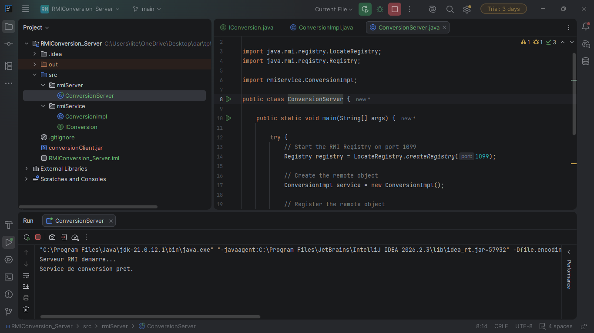
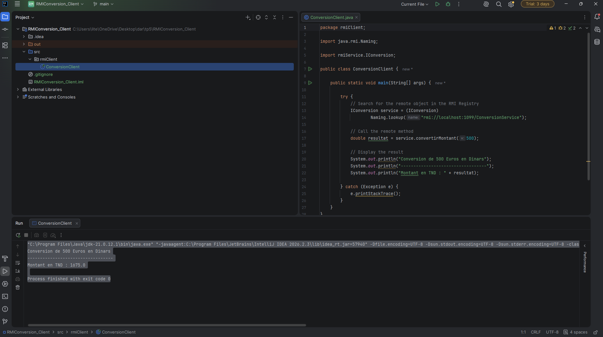

# TP5 – Java RMI : Service de conversion de devise

## Informations
- **Matière :** Développement d'Applications Réparties
- **Niveau :** LSI 3
- **Année universitaire :** 2026–2027
- **Activité :** 5-1 – Service de conversion de devise
- **Technologie :** Java RMI
- **JDK :** 21

## Objectif
L'objectif de ce TP est de mettre en œuvre une communication client/serveur avec Java RMI afin de réaliser un service distant de conversion d'un montant en euros vers le dinar tunisien.

## Structure du projet

### 1. RMIConversion_Server
- `IConversion.java` : Interface distante définissant la méthode `convertirMontant()`.
- `ConversionImpl.java` : Implémentation du service de conversion.
- `ConversionServer.java` : Démarrage du RMI Registry et publication de l'objet distant.

### 2. RMIConversion_Client
- `ConversionClient.java` : Recherche du service distant et invocation de la méthode de conversion.

### 3. Fichier JAR
- `conversionClient.jar` : Contient l'interface distante `IConversion` utilisée par le client.

## Fonctionnement
1. Le serveur démarre le registre RMI sur le port 1099.
2. Le serveur crée une instance de `ConversionImpl`.
3. L'objet distant est publié sous le nom `ConversionService`.
4. Le client recherche la référence distante dans le registre.
5. Le client invoque `convertirMontant(500)`.
6. Le serveur effectue le calcul et retourne le résultat.

## Résultat du test

Montant initial : 500 EUR

Taux utilisé : 1 EUR = 3.35 TND

Résultat obtenu : 1675.0 TND

## Captures d'écran

### Exécution du serveur

### Exécution du client

## Conclusion
Ce TP m'a permis de comprendre et de mettre en pratique le mécanisme Java RMI, notamment la définition d'une interface distante, l'implémentation d'un service, l'enregistrement dans le RMI Registry et l'invocation d'une méthode distante depuis un client.
